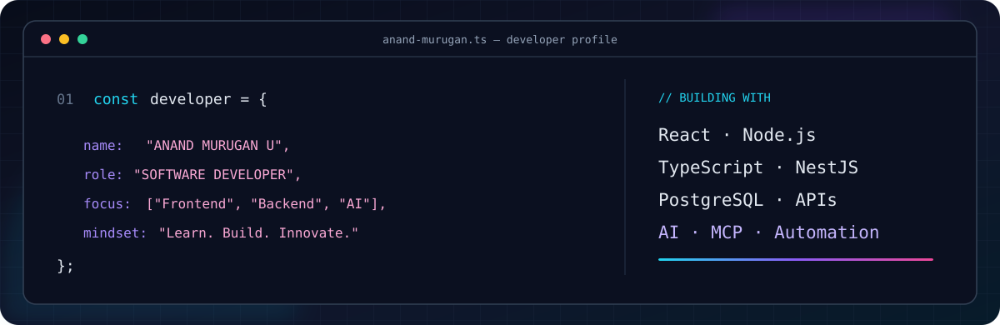

<div align="center">



<h1>ANAND MURUGAN U</h1>
<h3>SOFTWARE DEVELOPER</h3>
<p><b>Frontend Development&nbsp; • &nbsp;Backend Development&nbsp; • &nbsp;AI Technologies</b></p>

<a href="https://github.com/Anand-M14"></a>
<a href="https://www.linkedin.com/in/anand-murugan-u-/"></a>
<a href="mailto:anandmuruganu@gmail.com"></a>


</div>

---

## 01. About Me

```ts
const anand = {
  role: "Software Developer",
  education: "BCA",
  currentRole: "Development Intern @ Cloud Space Design",
  interests: [
    "Frontend Development",
    "Backend Development",
    "AI & Emerging Technologies"
  ],
  approach: "Understand • Build • Improve"
};
```

I'm a BCA graduate who enjoys building software from end to end. I like creating clean, responsive user interfaces, developing backend APIs, working with databases, and connecting different platforms. I'm also curious about AI technologies and how they can make applications and workflows more capable.

- **Frontend:** Responsive interfaces and user-focused web experiences.
- **Backend:** APIs, authentication, integrations, and database operations.
- **AI & Automation:** Exploring MCP, AI agents, Groq, and n8n.
- **Currently growing:** My skills across the software development ecosystem.

---

## 02. Technologies & Tools

<div align="center">

**LANGUAGES**
<br/>


**FRONTEND**
<br/>


**BACKEND & DATABASES**
<br/>


**DEVELOPER TOOLS**
<br/>


**AI & AUTOMATION**
<br/>


</div>

---

## 03. Projects & Practical Work

<table>
<tr>
<td width="50%" valign="top">

### ◈ Zoho CRM ↔ Pipedrive Integration

Working on CRM platform integration and data migration through APIs.

- Contacts, Leads, Accounts, and Deals
- OAuth 2.0 authentication
- Common field mapping
- Migration flows and duplicate handling

**Technologies:** NestJS · TypeScript · PostgreSQL · REST APIs

</td>
<td width="50%" valign="top">

### ◈ Vehicle Service Management

A web application project for managing vehicle and service information.

- Customer and vehicle records
- Service booking workflows
- Service history management

**Technologies:** React · Node.js · Express · Supabase

</td>
</tr>
<tr>
<td width="50%" valign="top">

### ◈ E-Commerce Website

A frontend project focused on a clean shopping experience.

- Product browsing and presentation
- Responsive page layouts
- Simple user navigation

**Technologies:** React · JavaScript · HTML · CSS

</td>
<td width="50%" valign="top">

### ◈ MCP & AI Agent Experiments

Exploring how AI models can interact with tools and backend services.

- MCP server and client practice
- AI tool integrations
- Groq-powered workflows
- n8n workflow automation

**Technologies:** NestJS · TypeScript · MCP · Groq · n8n

</td>
</tr>
</table>

---

## 04. Experience & Education

| | |
|:--|:--|
| **Experience** | Development Intern — Cloud Space Design |
| **Education** | Bachelor of Computer Applications (BCA) — Ambai Arts College |

---

## 05. GitHub Activity

<div align="center">


<br/><br/>


</div>

---

<div align="center">

### while (curious) { learn(); build(); repeat(); }

**Thanks for stopping by. Let's create something useful with code.**

<a href="https://github.com/Anand-M14">GitHub</a> &nbsp;·&nbsp;
<a href="https://www.linkedin.com/in/anand-murugan-u-/">LinkedIn</a> &nbsp;·&nbsp;
<a href="mailto:anandmuruganu@gmail.com">Email</a>

</div>